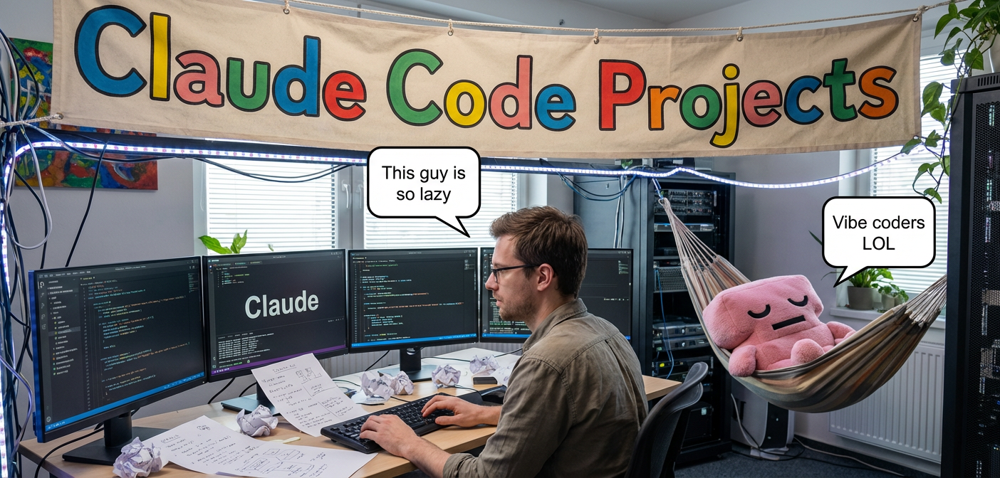
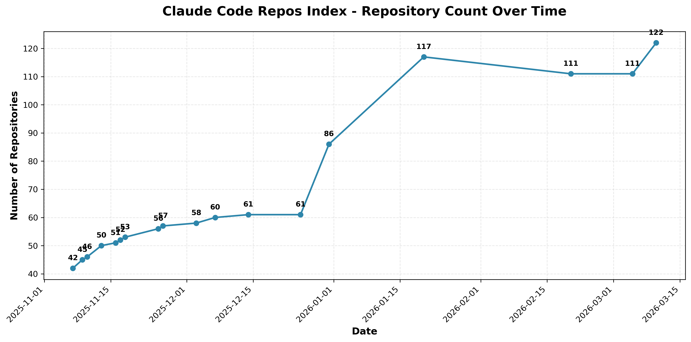

# Claude Code Projects Index

A curated collection of Claude Code projects, agent workspace blueprints, and related resources — organized by use case. Most patterns here adapt to other agentic AI CLIs and frameworks.

**Last Updated:** October 2026

**[Browse online](https://claude.danielrosehill.com)** · **[Plugins Marketplace](https://github.com/danielrosehill/Claude-Code-Plugins)** · **[Documentation portal](https://docs.bydanielrosehill.com)** · **[What are Claude Spaces?](./claude-spaces.md)**

> 🧭 **Start here: [Marketplace Guide](https://github.com/danielrosehill/Claude-Marketplace-Guide-Plugin)**. This is the suggested way into my [Claude Code Plugins Marketplace](https://github.com/danielrosehill/Claude-Code-Plugins). Install it (`/plugin install marketplace-guide@danielrosehill`) and ask Claude *"what's in the marketplace?"* or *"is there a plugin for X?"*. It browses every plugin by theme (Israel & Hebrew, homelab, Linux desktop, Claude Code tooling, shopping, writing…), recommends plugins for a task and shows what's new, all read live from the marketplace manifest.

---

## Contents

**Workspaces by Domain**
- [Systems Administration](#systems-administration)
- [Productivity & Planning](#productivity--planning) · [Legal](#legal) · [Health & Wellbeing](#health--wellbeing) · [Communications & Writing](#communications--writing) · [Financial Planning](#financial-planning) · [Career](#career) · [Business](#business) · [Privacy & Anonymity](#privacy--anonymity) · [Technology & Hardware](#technology--hardware) · [Marketing](#marketing)
- [Research](#research)
- [Argument and Perspective Exploration](#argument-and-perspective-exploration)

**Configuration & Tooling**
- [Context and Personalization](#context-and-personalization)
- [Multi-Agent Tooling](#multi-agent-tooling)
- [MCP (Model Context Protocol)](#mcp-model-context-protocol)

**Extensions & Scaffolds**
- [Plugins](#plugins)
- [Templates / Scaffolds](#templates--scaffolds) — *recommended way to spin up a new workspace*
- [Slash Commands](#slash-commands)

**Other**
- [Miscellaneous](#miscellaneous)

---

## About This Index

I've been using Claude Code daily for about six months — for development, but also audio editing, legal research, SEO analysis, health documentation, systems administration, and a long tail of non-code use cases. This index is the result: a collection of **agent workspaces** (repositories structured as self-contained environments for a specific activity) alongside supporting tooling — plugins, context files, MCP servers, and slash commands.

If there's a common thread, it's treating Claude Code less as a coding assistant and more as a general-purpose agent workspace that happens to run in a terminal.

| Type | What it is | Badge |
|------|------------|-------|
| **Agent Workspace** | Pre-configured repo using Claude as a conversational UI for a domain-specific workflow |  |
| **Template** | Forkable starting point you can customize |  |
| **Non-Code** | Applications beyond software development |  |

<strong>More context: the Agent Workspace Model, growth chart, praise</strong>

#### The Agent Workspace Pattern

All workspaces in this index follow the same pattern: a Git repository isn't just for code — it can serve as a complete, self-contained workspace for *any* activity. Each workspace uses a defined folder structure, a `CLAUDE.md` for agent instructions, slash commands, MCP configurations, and subagent definitions to create a purpose-built environment.

This pattern has been applied to everything from sysadmin and remote server management to legal research, health documentation, and financial planning — domains that have nothing to do with software development.

**Primitives globally, scaffolds per-cluster.** The tooling has been consolidated into **28 cluster plugins** (see [Plugins](#plugins)) — each one ships the domain primitives globally (commands, skills, agents for that cluster) and provisions a project scaffold on demand. So rather than forking a separate template repo for each new workflow, you install the relevant cluster plugin once and ask Claude Code to provision a scaffold wherever you need one.

#### Repository Growth

#### Praise

> *"This is either the work of a prolific genius, or a very clever bot (or both), although it hardly matters because the quality is so good - an index of 75+ Claude Code repositories published by the author... CMS, system design, deep research, IoT, agentic workflows, server management, personal health... If you spot the lie, let me know, otherwise please check these out."*
>
> — [awesome-claude-code](https://github.com/wong2/awesome-claude-code)

For the record: I'm a real human ([danielrosehill.com](https://danielrosehill.com)). The repos and workspaces in this index are generated with Claude Code but human-designed and refined.

#### Additional reading

- 📝 **[Notes on Templates & Workspaces](./notes.md)**
- 📖 **[What are Agent Workspaces?](./claude-spaces.md)**

---

# Systems Administration

Projects involving using Claude for local or remote systems administration as distinct from development-related projects.

> **See also:** The **[Claude Code Sysadmin Workspaces Index](https://github.com/danielrosehill/Claude-Code-Sysadmin-Workspaces-Index)** is a dedicated sub-index for all sysadmin workspace templates.

### Bash Alias Manager Claude

Workspace for managing bash aliases with YADM synchronization support.

---

### Claude Code Bash Aliases

Collection of bash aliases for common Claude Code operations on Linux.

---

### Claude LAN Manager 0126

GUI concept for Claude-driven LAN management, covering device discovery and network operations.

---

### Claude Linux Desktop Manager Notes 0426
 

Planning workspace for managing a Linux desktop with an agentic CLI, running raw notes through a refine/analyse/workflow pipeline.

---

### Claude OS

Multi-plugin installation and setup utility for orchestrating everyday Linux desktop use through Claude Code.

---

### Claude OS Playbook
 

Template using Claude Code as an Ansible stand-in for repetitive environment setup and supervision.

---

### Claude Rescue

Concept for deploying Claude Code into recovery shell environments for AI-assisted system repair.

---

### Claude Rescue Pi

Raspberry Pi jump host running the Claude Code CLI over Cloudflare Access and Tailscale as an emergency recovery surface for a Linux workstation.

---

### Claude System Recovery Mode

Custom GRUB boot entry integrating Claude CLI into Linux system recovery workflows.

---

## Linux - KDE Plasma

Projects specifically targeting KDE Plasma desktop integration and Linux desktop workflows with Claude Code.

### Claude Konsole Launcher

Launch utility for pairing Claude Code with Konsole on KDE Plasma.

---

### Conda Management Plugin
 

Early standalone Claude Code plugin with slash commands for managing Conda environments and packages.

---

### Desktop Ops Workspace Template
  

Per-machine, local-first SQLite log of everything the agent installed, fixed or diagnosed on a Linux desktop, so later sessions can query history before acting. Pairs with `linux-desktop-plugin`.

---

### Dolphin AI Actions

KDE Dolphin right-click service menus that open the selected directory in Claude Code or Codex, in normal or permissive mode.

---

### KDE Claude Runner

Plan for a KDE-native runner that starts and supervises Claude Code sessions from the desktop.

---

### LAN Manager Plugin
  

Claude Code plugin that turns a LAN into working memory: devices, services, operating systems, ports and topology captured in a greppable knowledge store that grows as you and Claude discover things.

---

### Server Management Plugin
 

Early standalone Claude Code plugin with slash commands for server monitoring, deployment and administration.

---

### Synology Manager Plugin

Claude Code plugin for administering a Synology NAS over SSH, with guided first-run setup, persistent context and commands for shares, volumes, mounts and storage monitoring.

---

# Productivity & Planning

Workspaces for decision-making, personal planning, file management, and general-purpose productivity workflows.

> **See also:** The [Budgeting](https://github.com/danielrosehill/Claude-Budgeting-Plugin), [Personal Planning](https://github.com/danielrosehill/Claude-Personal-Planning-Plugin), [Career](https://github.com/danielrosehill/Claude-Career-Plugin), [Purchasing](https://github.com/danielrosehill/procurement-tools-plugin), [Shopping](https://github.com/danielrosehill/Claude-Shopping-Plugin), and [Ideation & Planning](https://github.com/danielrosehill/Claude-Ideation-Planning-Plugin) cluster plugins in the [Plugins](#plugins) section cover these domains.

### Agent-Assisted Purchase Research Index

Index of templates, skills and demos for agent-driven purchase research, built on decoupling the requirements spec from the current market.

---

### Agentic Purchase Pipeline
 

Staged, agent-supported process for evaluating any purchase over about $50: capture the spec, find the requirements, survey the market, then score candidates against the spec.

---

### Claude Decision Mapper
 

Codifies the iterative spec-refinement loop used with Claude for builds, hardware purchases and home-lab decisions — draft spec, correction, refinement — as reusable skills.

---

### Claude Shopping Demo 2
 

Model workspace for a Claude shopping research tool customised by shop whitelist and task, with input and output folders.

---

### Claude Shopping Eval Demo
 

Demo of Claude Code as a consumer purchasing assistant: a written spec plus retailer catalogue screenshots go in, a ranked recommendation report comes out (worked example: a portable Bluetooth speaker).

---

### DVR Transcriber
 

Work-in-progress CLI and workspace for importing recordings from a digital voice recorder, organising them into dated folders, classifying them with AI and transcribing them.

---

# Legal

Workspaces and templates for legal research, case management, and evidence handling workflows.

> **See also:** The [Legal & Investigative](https://github.com/danielrosehill/Claude-Legal-Investigative-Plugin) cluster plugin in the [Plugins](#plugins) section covers this domain — evidence logging, document analysis, redaction, and brief generation.

### Claude Case File
  

Claude Code template for building version-controlled containers for legal files and case material.

---

# Health & Wellbeing

Workspaces and templates for health documentation, medical visit management, therapy tracking, and health-related research.

> **See also:** The [Personal Planning](https://github.com/danielrosehill/Claude-Personal-Planning-Plugin) cluster plugin in the [Plugins](#plugins) section covers this domain — diary, health, therapy, preparedness, and personal development variants.

### Claude ADHD Research Workspace
  

Research notebook investigating ADHD medication access, structured for sustained Claude-assisted enquiry.

---

### Claude Mental Health Templates Index
 

Subindex of Claude Code templates, plugins and workspaces for mental health work a person does on their own material: organising events, tracking therapy, preparing for appointments.

---

### Claude Therapy Workspace Template
   

GitHub template for working through one bounded personal issue with Claude Code — a career situation, a relationship, a bereavement — with sessions, threads and timelines kept in one workspace per issue.

---

# Communications & Writing

Workspaces and templates for content creation, blog management, writing workflows, and communications strategy.

### Agentic Book Writing
 

Pattern spec for writing full-length reference and instructional books with Claude Code, using teams of subagents and the repository as shared memory, through to a print-on-demand paperback.

---

### AI Video Production Template
  

Per-project workspace skeleton for producing one AI-generated video; the state half of a pair whose operational half is the `ai-video-producer` plugin (scripting, image-to-video and lip-sync pipelines).

---

### Claude Book Workspace Template
   

Workspace scaffold implementing the Agentic Book Writing pattern: a `book.toml` manifest, spec and interview folders, binding prose and graphics style guides, and a status script for subagent-driven drafting.

---

### Claude Website Update Sender

Automated workflow for sending polished update emails about website changes via Resend MCP.

---

### Declaude
 

Personalized text rewriting rules that consolidate into a slash command for refining AI-generated documentation.

---

### RTL Conformity Skills

Instruction-only agent skills that keep Hebrew, Arabic, Farsi and Urdu text right-to-left on every surface an agent writes to (Gmail, Resend, Google Docs/Sheets/Slides) and verify the setting took. Works in Claude and ChatGPT.

---

### Writing Editing Plugin
 

Early standalone Claude Code plugin with slash commands for proofreading, style editing and text transformation.

---

# Financial Planning

Workspaces and templates for budgeting, purchasing decisions, and personal finance management.

> **See also:** The [Budgeting](https://github.com/danielrosehill/Claude-Budgeting-Plugin), [Purchasing](https://github.com/danielrosehill/procurement-tools-plugin), and [Shopping](https://github.com/danielrosehill/Claude-Shopping-Plugin) cluster plugins in the [Plugins](#plugins) section cover these domains.

### Claude FX Pair Analyst Template
  

Claude Code workspace for FX pair analysis — historical data, quant and vol modelling, geopolitical context, and Typst PDF reports.

---

### Israel Mortgage Research Skills

Work-in-progress skills basket for buyer-side Israeli residential mortgage research — track mix, Bank of Israel rules, DSR/LTV limits and bank quirks — before verified skills are folded into the Israel agent-skills plugin.

---

### Israel Property Research Skills

Work-in-progress skills basket for Israeli property due diligence (Tabu extracts, building files, usage permits, comparables), aimed at non-professional buyers and tenants.

---

# Career

Workspaces and templates for job searching, career planning, and professional development.

> **See also:** The [Career](https://github.com/danielrosehill/Claude-Career-Plugin) cluster plugin in the [Plugins](#plugins) section covers this domain — role logging, offer comparison, application tracking, and salary benchmarking.

# Business

Workspaces and templates for business planning, idea evaluation, and organizational continuity.

> **See also:** The [Ideation & Planning](https://github.com/danielrosehill/Claude-Ideation-Planning-Plugin) cluster plugin in the [Plugins](#plugins) section covers business idea evaluation, decision frameworks, and simulation workflows.

# Privacy & Anonymity

Workspaces and templates for document redaction, identity protection, and PII obfuscation.

> **See also:** The [Legal & Investigative](https://github.com/danielrosehill/Claude-Legal-Investigative-Plugin) cluster plugin in the [Plugins](#plugins) section includes redaction and document-obfuscation workflows. For broader system hardening see the [Security Checkup](https://github.com/danielrosehill/Claude-Security-Checkup-Plugin) plugin.

### Claude Anonymisation Assistant Plugin

Assistant configuration for redacting personally identifiable details from documents.

---

# Technology & Hardware

Workspaces for hardware planning, PC builds, and technology procurement.

> **See also:** The [Purchasing](https://github.com/danielrosehill/procurement-tools-plugin) (includes a tech-procurement variant), [Sysadmin & Homelab](https://github.com/danielrosehill/Claude-Sysadmin-Homelab-Plugin), and HP5200 Printer plugins in the [Plugins](#plugins) section cover these domains.

### Claude Pad
 

Dedicated macropad for driving Claude Code — approve, stop, new session, transcript navigation — with a host-driven status LED that lights when Claude is waiting on you.

---

### Claude Monitor Research
 

Ergonomic and geometric research into a display for running a grid of at least eight concurrent Claude Code sessions, measured in text cells rather than inches, plus the software layer for navigating the grid.

---

### Home Media Planner
  

Non-code planning workspace for a home media setup: ideas, voice notes and reference material refined into requirements and decisions.

---

# Marketing

Workspaces for SEO, web analytics, PR monitoring, and media tracking.

> **See also:** The [PR & Media Work](https://github.com/danielrosehill/Claude-PR-Media-Work-Plugin) cluster plugin in the [Plugins](#plugins) section covers coverage scanning, press summarisation, response drafting, and comms strategy.

# Research

Projects using Claude and agentic systems for deep research, report generation, and information synthesis.

> **See also:** The [Research Space](https://github.com/danielrosehill/Claude-Research-Space-Plugin) cluster plugin in the [Plugins](#plugins) section covers deep research, technical research, OSINT, geo-reaction, stack, ecosystem, and competitor research workflows.

**[See full list in the dedicated research page →](./research.md)** (13 entries)

---

# Argument and Perspective Exploration

Projects using AI for synthesized debate to explore various perspectives, including policy modeling and analysis.

### Claude AI Conference
 

Simulated conference in which agentic personas (HR leads, CEOs, doctors, artists, sceptics) each deliver a three-minute talk on "AI in 2026", rendered with TTS.

---

### Claude Change My View
   

Workspace for challenging personal beliefs through AI-generated counterarguments and rebuttals.

---

### Panel Of Claude
 

Exploratory model running multiple agents as a panel debate.

---

### Perspective Finder Prompt
 

Claude Code workspace for finding people who hold specific viewpoints within a policy debate, surfacing voices that keyword search misses.

---

# Context and Personalization

Projects exploring using Claude and related tooling for personalized user engagement, including through RAG, interviewing methods, and context injection.

### AI Dev Repo Template 1
 

GitHub template repository pre-seeded with every AI Dev Workspace Primitive as a stub, with instructions for the user or agent to fill each one in.

---

### AI Dev Repo Template Oct 2025
 

October 2025 template for AI-assisted development with a layered `CLAUDE.md` hierarchy that guides the agent through project stages.

---

### AI Dev Workspace Primitives

Index of root-level `UPPERCASE.md` context primitives for AI-assisted repos (`SPEC.md`, `RULES.md`, `TOOLS.md`, `SECRETS.md`, `GROUNDING.md` and more), each published as its own repo and injectable via `CLAUDE.md`/`AGENTS.md`.

---

### Batch ClaudeMD Repo Creator

Automation workspace for batch-adding CLAUDE.md files across multiple GitHub repositories.

---

### Claude Code Repo Managers ClaudeMD
 

Pre-configured CLAUDE.md templates for managing different repository types.

---

### Claude Context Analysis 0526

Redacted point-in-time dump of `/context` from a heavily-pluginned Claude Code session, analysing where the context budget actually goes and what is eagerly versus lazily loaded.

---

### Claude Foundations

Index of the user-level layer of a Claude Code setup, treated as one system — entrypoint, reference context, habits and discovery — covering what loads before any task is known.

---

### Claude Model Identifier
 

Prompt template for verifying the correct Claude model variant at conversation start.

---

### Claude Spend Approval Limit
 

Paste-ready CLAUDE.md / AGENTS.md snippet that gives an agent a spending approval limit: it spends freely on paid APIs below a tunable threshold, and above it must estimate the cost, offer a cheaper route and wait for approval.

---

### Claude User Context Pattern
 

Depersonalised reference pattern for organising user-level `~/.claude/` context: a lean top-level `CLAUDE.md` that routes to topical `context/*.md` files (system environment, git rules, MCP usage, file organisation, etc.) loaded only when relevant.

---

### ClaudeMD Turnstile
  

Pattern for maintaining separate CLAUDE.md files for developers and for end users of the same repository.

---

### CONTEXT.md
 

Workflow methodology for separating human-authored context from structured AI agent briefings.

---

### Agent Habits
 

Splits a user-level system prompt into one file per standing habit, assembled into a pasteable block and a JSON index. Ships skills to install a subset into any CLAUDE.md and to reconcile drift when the prompt and the repo disagree.

---

### Home Folder Claude MD
 

Working CLAUDE.md for a home directory on an Ubuntu Linux desktop.

---

### Linux Desktop ClaudeMD Seeder
 

Automatically generates contextual CLAUDE.md files across a Linux desktop filesystem.

---

### My Tone Of Voice

Annotated corpus of writing samples used as ground truth for a personal writing style, with reusable methodology for building a tone-of-voice reference for AI agents.

---

### Private And Public Claude MD

Tools for managing public and private CLAUDE.md files with security-focused git configuration.

---

### Split Claude MD Pattern
  

Pattern for splitting a home-level CLAUDE.md into directives plus on-demand context files, optimised for context handling.

---

### State Of Claude Context 0426

Q&A notes on where context bloat accrues given the current shape of the Claude Code harness and its primitives.

---

### The User Voice Types
  

CLAUDE.md snippets and slash commands telling Claude to silently infer around transcription errors from voice typing and stray keystrokes from one-handed or distracted typing.

---

# Multi-Agent Tooling

Components and tooling for multi-agent development and orchestration frameworks.

## Multi-Agent Systems

### Agent Briefing Gateway
 

Design model for an orchestration agent that buffers a human from a batch of working sub-agents — one consolidated brief per cycle, a budgeted override channel, and resumable approval gates.

---

### Agent Handover Demo
 

Pattern for handing tasks between code-generation agents working on different machines through shared handover docs, giving supervising humans an audit trail of what each agent did.

---

### Claude Agent Picker Pattern
 

Framework for assembling context-optimized multi-agent crews with minimal overlap.

---

### Claude Agent Workspace Generator
 

Launchpad for creating standardized workspace templates conforming to the Agent Workspace Model v1.1 spec, with slash commands to generate, validate, and publish new workspaces.

---

### Claude Air Traffic Control
 

Workspace model for one operator running agentic AI across many repositories all day, borrowed from air traffic control: a voice-first shift manager routes work across concurrent Claude Code sessions. Published as a 26-page typeset document.

---

### Claude Fleet Traffic Shaper
 

Specification for a local proxy that assigns priorities to concurrent Claude Code sessions and shapes their aggregate traffic, so rate limiting degrades background work instead of landing at random. Includes a prior-art survey of the multi-agent proxy and queueing landscape.

---

### Claude Development Agents
 

Curated toolkit of 74+ Claude Code configurations for development workflows and multi-agent coordination.

---

### Claude Sub-Agent Network
 

Collection of system prompts and configurations for development, operational, and creative tasks.

---

### Cool Claude Code Stuff

Curated collection of Claude Code projects and resources organized by category.

---

## Workspace Setup & Management

### Claude Plugin Workspace Vault
 

Architecture for Claude Code plugins that do sustained work: a public plugin, a private workspace instantiated from a template repo, and a vault at `~/.claude-plugins/<name>/` for user data.

---

### Claude Skill Definer
 

Multimodal workspace for defining Claude Code skills from voice notes, videos, images and text, or written specs.

---

### Claude Vault Idea

Idea capture for a meta-plugin holding a personal vault of plugins and MCP servers, activated selectively per project to mitigate eager plugin description loading at user level.

---

### Claude Workspace Setup Helper
 

Interactive tool for discovering, selecting, and cloning Claude Workspace templates.

---

# MCP

Projects related to Claude and MCP tooling and setup.

### AI Tools Plugin
 

Early standalone Claude Code plugin with slash commands for AI tool management and MCP server configuration.

---

### Claude Code MCP Command Generator

Generator for creating MCP server configuration commands for Claude Code.

---

### Claude Code MCP List

Curated index of MCP servers organized into 14+ categories for extending Claude Code.

---

### Claude MCP Guidelines
 

Home-folder CLAUDE.md snippet giving an agent guidance on which MCP server to reach for.

---

### Claude Meta MCP Slash
 

Template `/install-mcp` slash command that routes MCP server installations across multiple MetaMCP instances using a tiered preference system.

---

### How-To-MCP

Guide for instructing AI agents on how to provision and manage MCP server connections according to user-specific preferences, with a tiered decision matrix.

---

### MCPM Claude Code Docs

Documentation for integrating Claude Code with MCPM external MCP server manager.

---

### Smithery Claude Code MCP Jumpstarter

Curated collection of 35+ MCP servers with interactive installer across 15+ categories.

---

<!-- GENERATED FROM data/marketplace.json — do not edit by hand. Run scripts/sync_marketplace.py or npm run build. -->

# Plugins

All plugins registered in the [danielrosehill marketplace](https://github.com/danielrosehill/Claude-Code-Plugins). Install any of these with `/plugin install <name>@danielrosehill`.

## Systems Administration

**[See full list in the dedicated plugins page →](./plugins.md)** (187 entries)

---

# Templates / Scaffolds

Scaffolds used to be distributed as ~100 standalone template repos and a `New-Repo-From-Template` plugin. That pattern was retired in the April 2026 reshape.

**Scaffolds now live inside the [cluster plugins](#plugins).** Each of the 28 cluster plugins bundles the workspace primitives for its domain (commands, skills, agents, MCP configs) and exposes a provisioning skill that writes a fresh per-project scaffold on demand — so instead of cloning a template repo, you install the relevant plugin once and ask Claude Code to scaffold a new workspace for whatever project you're starting.

See the [Plugins](#plugins) section above for the full cluster list.

---

# Slash Commands

Individual slash commands, sometimes integrated into other plugins or sometimes just for use at the user level.

> **See also:** The **[Claude Slash Commands](https://github.com/danielrosehill/Claude-Slash-Commands)** repo serves as both a 350+ command library and the dedicated index for all slash command repos.

### AI-Human Attribution Adder
 

Adds AI/human attribution sections to README files for transparent tool usage documentation.

---

### Claude App Optimiser
  

Slash command deploying a sub-agent for codebase optimization and dead code removal.

---

### Claude Calls The Shots
 

Flips Claude Code into autonomous, action-first mode — ships a per-session `/calls-the-shots` slash command plus an optional always-on snippet injected into `~/.claude/CLAUDE.md`.

---

### Claude Code Linux Desktop Slash Commands
 

System administration slash commands for Linux desktop environments.

---

### Claude MD Chunk
 

Slash command that condenses bloated CLAUDE.md files to essentials and organizes supplementary context into a structured `agent-context/` folder.

---

### Claude Slash Commands
 

General-purpose slash command library for various Claude Code workflows.

---

### Document As You Go
 

Drop-in system prompt and slash command that make coding agents capture what they discover — undocumented APIs, auth flows, dead ends — instead of losing it when the session ends.

---

### General Dev Plugin
 

Early standalone Claude Code plugin with slash commands and agents for code generation, refactoring and general development.

---

### Git GitHub Plugin
 

Early standalone Claude Code plugin with slash commands and agents for Git version control and GitHub repository management.

---

### No Wheel Inventions
  

Slash commands encouraging use of existing libraries instead of building custom solutions.

---

### Split Context Setup
 

Slash command that prunes a repo's `CLAUDE.md` to essentials and scaffolds a topic-based `context/` store, an ingestion pipeline for raw materials, and subagents for context maintenance.

---

# Miscellaneous

Other projects including meta-resources, feedback, and utilities that span multiple categories.

**[See full list in the dedicated misc page →](./misc.md)** (32 entries)

---

# Ideas & WIP

Early-stage repositories: ideas, planning notes, placeholders and work-in-progress skills baskets that have not yet become a working tool, workspace or plugin. Some are stubs. They are listed so the idea is findable, not because there is anything to install.

### Agent Context Harness

Idea: a per-turn router that sends each message to the current task, an existing parallel worker or a new session, keeping unrelated tasks out of one agent's context.

---

### Claude Background Hook Planner

Placeholder for planning a Claude Code background hook.

---

### Claude MD Experiments

Empty placeholder for experiments with `CLAUDE.md` structure.

---

### Claude Skills Model 0526

Stub for planning notes on the plugins and skills mechanism (May 2026).

---

### Claude Voice Notifier

Planning repo for Claude placing a real outbound phone call to deliver a one-time, task-specific spoken message on the user's behalf.

---

### Israel Medication Research Skills
 

Stub workspace for agent skills that check medication availability in Israel for patients, to be folded into the Israel agent-skills plugin.

---

### Voice Note Task Classifier

Planned multi-label classifier that routes voice-note transcripts to task-specific subagents (email, calendar, shopping list, to-do, dev spec), each holding one MCP tool.

---
